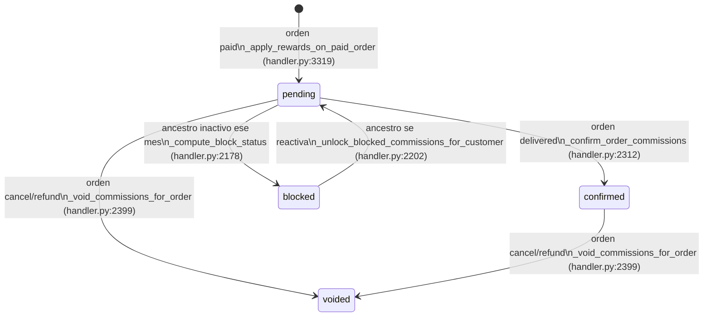

# Arquitectura backend — Finding'U (gamification-multinivel)

> Fuente de verdad de la arquitectura backend de este monorepo. Última verificación: 2026-08-01.

## 1. Propósito y alcance

Este documento describe el backend real de la plataforma MLM/gamificación **Finding'U** (findingu.com.mx), verificado por lectura directa de código, no por diseño aspiracional.

`gamificacion-multinivel-f/docs/dynamodb-plan.md` es un documento de planeación histórico (modelo de datos previsto antes de implementar). **Quedó obsoleto**: no referencies patrones de acceso, GSIs o entidades de ese archivo como estado actual — lo que manda es lo descrito aquí, verificado contra `handler.py` y `Micro-lambda-GMF/`. Si hay discrepancia entre `dynamodb-plan.md` y este documento, este documento gana.

Alcance: backend (Lambda, DynamoDB, integraciones AWS/terceros) de las dos implementaciones coexistentes del dominio (monolito y split en microlambdas). No cubre frontend Angular salvo para señalar dónde el frontend simula (`MockApiService`) funcionalidad que el backend no implementa (sección 10).

## 2. Panorama: monolito vs. split

| | Monolito | Split (`Micro-lambda-GMF/`) |
|---|---|---|
| Ubicación | `gamificacion-multinivel-f/lambda/handler.py` (6,515 líneas) | `Micro-lambda-GMF/python/*.py` (9 módulos) |
| Runtime | Un solo Lambda, Python + boto3, sin framework web | Varios Lambdas Python especializados |
| Enrutamiento | Dispatch manual por diccionario de tuplas dentro de un único `lambda_handler` | Contrato `Micro-lambda-GMF/openapi-aws.yaml` (OpenAPI 3.0) pensado para importar en API Gateway REST v1, con rutas explícitas + `{proxy+}` por recurso |
| Orquestación async | No existe (todo síncrono dentro del handler) | `Micro-lambda-GMF/python/stepFunctions.json` orquesta comisiones/analítica post-evento |
| Estado del refactor | Código vive dentro del proyecto **frontend** Angular (`gamificacion-multinivel-f/`), no en su propio paquete | Deuda técnica documentada en `docs/order-architecture-refactor-notes.md`: lógica de dominio de órdenes mezclada en `core_utils.py`, pendiente de extraer a `order_domain.py`/`order_repository.py` |

**⚠️ MONOLITO ELIMINADO DE AWS (2026-08-01)**: la API legacy `m85v7secp8` y la Lambda `Multinivel` fueron **borradas** tras validar cobertura completa (87/87 endpoints del frontend en microlambdas, features exclusivas portadas, sin dominios mapeados, sin tráfico desde 2026-04, sin pagos MP en vuelo con el webhook viejo). El único backend es `Micro-lambda-GMF/` detrás del API `ge2omdgk33`; el bundle de producción en findingu.com.mx (S3 `findingu-ventas` + CloudFront `E2X33PJJEGJZJ5`) lo consume. `gamificacion-multinivel-f/lambda/handler.py` se conserva en el repo SOLO como referencia histórica (el código desplegado que difería fue portado al repo antes del borrado — ver `docs/qa/06`). Los recursos `/coupons` y `/user-dashboard` del gateway ya existen (cutover completado).

**Despliegue real (verificado contra AWS el 2026-08-01, cuenta 049945345964, us-east-1)**:

- API **dev** `ge2omdgk33` ("FindingU Multi-Level API Proxy", la que usa `environment.ts`) enruta a las **microlambdas**: `/auth`, `/login`, `/crearcuenta`, `/password`, `/employees` → `Multinivel-Auth`; `/orders` → `Multinivel-order`; `/catalog`, `/products`, `/assets`, `/notifications` → `Multinivel-catalog`; `/customers`, `/network` → `Multinivel-costumer`; `/dashboard`, `/user`, `/admin` → `Multinivel-Dashboard`; `/commissions` → `Multinivel-Comissions`; `/inventory`, `/stocks`, `/pos` → `Multinivel-inventory`; `/shipping` → `Multinivel-shiping`.
- API **prod** `m85v7secp8` ("Multinivel-API", la que usa `environment.prod.ts`) enruta TODO (`/Multinivel/{proxy+}`) al **monolito** Lambda `Multinivel`.
- Tabla DynamoDB `multinivel` existe en la cuenta. Conclusión: **dev ya corre el split; producción sigue en el monolito**. Re-verificar este mapeo si pasa el tiempo (`aws apigateway get-integration`).

## 3. Router y entrada HTTP (monolito)

- Punto de entrada único: `lambda_handler(event, context)` — `gamificacion-multinivel-f/lambda/handler.py:6417`.
- Sin framework (no Flask/FastAPI/Chalice): resuelve método HTTP (`requestContext.http.method` o `httpMethod`) y segmentos de path manualmente.
- Dispatch por diccionario/tuplas: clave `(len(segments), segments[0], method)`, evaluado como cadena de `if` sobre `route_key`, agrupado por número de segmentos (1 a 4) — `handler.py:6437-6515`. Comentario explícito del propio código: *"Dispatcher Map for O(1) routing instead of O(N) if/else"* (`handler.py:6433-6436`).
- Ejemplos de rutas reales: `POST /login` → `_login` (`handler.py:6440`), `POST /shipping/quote` → `_get_shipping_quote` (`handler.py:6449`), `PATCH /orders/{id}` → `_update_order_status` (`handler.py:6478`), `POST /webhooks/mercadolibre` → `_mercadolibre_webhook` (`handler.py:6493-6494`), `GET /associates/{id}/month/{mes}` → `_get_associate_month` (`handler.py:6511`).
- Ruta no encontrada → `404` con payload `{"message": "Ruta no encontrada", ...}` (`handler.py:6515`).
- Auth: headers `x-user-id` / `x-user-name` / `x-user-role` en cada request protegida (usados como identidad ligera, no solo JWT); login emite JWT propio vía `_login` (`handler.py:6342`).

## 4. Modelo de datos real: patrón "bucket + REF"

Tabla DynamoDB única. Nombre por variable de entorno `TABLE_NAME`, default `"multinivel"` — `handler.py:21`.

Cada entidad se persiste **dos veces** mediante `_put_entity` (`handler.py:639-697`):

```python
def _bucket_pk(entity: str) -> str:      # handler.py:630
def _ref_pk(entity: str, entity_id: Any) -> str:   # handler.py:633
def _make_bucket_sk(created_at_iso: str, entity_id: Any) -> str:  # handler.py:636
```

1. **Ítem bucket**: `PK=<ENTITY>`, `SK=<createdAt ISO>#<id>` → permite listados cronológicos por `Query` sobre la partición de la entidad (orden natural por `SK`).
2. **Ítem ref**: `PK=<ENTITY>#<id>`, `SK="REF"` → lookup O(1) por id (`_get_ref`, `handler.py:699`; `_get_by_id`, `handler.py:703`).

**Sin `TransactWriteItems`**: la doble escritura (bucket + ref) no es atómica. El propio código lo reconoce y acepta el riesgo (comentario en `_put_entity`, `handler.py:639-697`, zona de la doble escritura ~línea 661-662). Implicación operativa: una falla parcial entre ambas escrituras puede dejar inconsistencia bucket/ref; no hay compensación automática documentada.

### Entidades en uso (verificado por `_put_entity("...")` en `handler.py`)

`ADMIN_EVENT` (940), `AUTH` (964, 6279), `PASSWORD_RESET` (1144), `CONFIG` (1540, 1556, 1580), `ASSOCIATE_MONTH` (1687), `CUSTOMER` (2086, 4052, 4103), `ORDER` (3149, 5256), `PRODUCT_CATEGORY` (3805), `PRODUCT` (3878), `CAMPAIGN` (3968), `ASSET` (3994, 4011), `INVENTORY_MOVEMENT` (4475), `STOCK` (4745), `STOCK_DAMAGE` (4832), `STOCK_TRANSFER` (4904), `POS_CASH_CUT` (5125), `POS_SALE` (5267), `COMMISSION_REQUEST` (5406), `COMMISSION_RECEIPT` (5454, 5478), `NOTIFICATION` (5682), `PRODUCT_OF_MONTH` (6049), `EMPLOYEE` (6265).

### Entidades especiales fuera del patrón bucket+REF

- **`ASSOCIATE_MONTH`**: estado mensual de volumen/actividad por asociado. Lectura vía `_get_month_state` (`handler.py:1656`); aunque también pasa por `_put_entity` (línea 1687), su propósito es acumulador mensual, no catálogo cronológico genérico.
- **`COMMISSION_MONTH`**: ledger de comisiones por beneficiario y mes. Clave explícita `PK="COMMISSION_MONTH"`, `SK="#BENEFICIARY#<id>#MONTH#<mes>"` (`_commission_month_sk`, `handler.py:2131-2132`; lectura en `_get_commission_month_item`, `handler.py:2134-2138`). Contiene `ledger`, `totalPending`, `totalConfirmed`, `totalBlocked` (campos gestionados por `_recalc_commission_totals`, `handler.py:2163+`).

### Sin GSIs

No existen Global Secondary Indexes en la tabla. Única mención de "GSI" en todo `handler.py` es un comentario reconociendo la limitación: *"Optimization: If email was a GSI, this would be faster."* (`handler.py:970`). La búsqueda por email hoy se resuelve con **bucket scan** — limitación de performance conocida y aceptada, no hay índice que la mitigue. No inventar GSIs al documentar o diseñar sobre este backend sin verificar antes que se hayan creado en AWS.

## 5. Motor de red de referidos y metas gamificadas

- **Árbol de referidos**: `_build_network_tree_with_month` (`handler.py:279`) construye el árbol a partir de `leaderId` de cada `CUSTOMER`; calcula `monthSpend` e `isActive` por nodo y ordena hijos por gasto descendente.
- Helpers de árbol: `_trim_tree_by_depth` (`handler.py:346`, poda por profundidad), `_flatten_tree` (`handler.py:360`, aplanado a lista), `_network_members_from_tree` (`handler.py:373`, lista de miembros acotada, default `max_rows=30`).
- **Metas gamificadas**: `_build_goals` (`handler.py:459`) genera 7 metas dinámicas por usuario: activo mensual, 3 niveles de descuento, invitar miembro, activar miembro de red, todos los directos activos, red que replica. Marca `primary`/`secondary` según la primera meta no lograda en ese orden.

## 6. Activación mensual y descuentos por consumo

- **Activación**: umbral configurable `activationNetMin`, default `Decimal("2500")` MXN (`_default_rewards_config`, `handler.py:1323`), evaluado contra `netVolume` del mes vía `ASSOCIATE_MONTH`.
  - `_upsert_month_volume` (`handler.py:1671`) acumula el volumen neto mensual del asociado.
  - `_is_active` (`handler.py:1707`) y su variante cacheada `_is_active_cached` (`handler.py:1711`) determinan si el asociado está activo ese mes.
- **Descuentos por consumo**: tiers default definidos en `_default_rewards_config` (`handler.py:1324-1328`):
  - `$3,600–$8,000` → 30%
  - `$8,001–$12,000` → 40%
  - `$12,001+` → 50%
  - Cálculo: `_calc_discount_rate` (`handler.py:1604`) resuelve la tasa según subtotal bruto; `_effective_discount_rate_for_order` (`handler.py:1614`) aplica la tasa efectiva a una orden concreta.

## 7. Motor de comisiones multinivel

Constantes base (`handler.py:73-78`):
```python
MAX_COMMISSION_LEVELS = 3
DEFAULT_COMMISSION_BY_DEPTH = {1: Decimal("0.10"), 2: Decimal("0.05"), 3: Decimal("0.03")}
```
Configurable vía `commissionLevels` en `CONFIG` (rate + `minActiveUsers`/`minIndividualPurchase`/`minGroupPurchase` por nivel, `handler.py:1329-1332`), con fallback a `DEFAULT_COMMISSION_BY_DEPTH` si no hay override (`_commission_rate_for_depth`, `handler.py:2140-2161`).

- **Cadena ascendente**: `_upline_chain` (`handler.py:2104`) sube por `leaderId` hasta `max_levels` (default 3) con `safety_cap=50` contra ciclos.
- **Requisitos extra por nivel**: `_check_commission_requirements` (`handler.py:3261`) valida mínimos de directos activos y compra individual/grupal por nivel antes de aplicar la tasa.

### Ciclo de vida de una comisión



- **`paid`** → `_apply_rewards_on_paid_order` (`handler.py:3319`) crea filas `status=pending` por cada beneficiario de la cadena ascendente. Idempotente vía `rowId = ORDER#<id>#L<nivel>`. Incluye comisión *one-shot* del 10% por compras de invitados (guest), atribuida al referidor.
- **`delivered`** → `_confirm_order_commissions` (`handler.py:2312`) transiciona `pending → confirmed` (usa `_upline_chain` con `MAX_COMMISSION_LEVELS`, `handler.py:2331`).
- **`cancel`/`refund`** → `_void_commissions_for_order` (`handler.py:2399`) anula comisiones asociadas a la orden (también usa `_upline_chain`, `handler.py:2409`).
- **Bloqueo ("hard cut, no pass")**: `_compute_block_status` (`handler.py:2178`) y `_unlock_blocked_commissions_for_customer` (`handler.py:2202`) — si algún ancestro de la cadena no está activo en el mes, la comisión queda bloqueada; no hay "paso" al siguiente nivel activo (regla `cutRule: "hard_cut_no_pass"` en `_default_rewards_config`, `handler.py:1335`).
- Ledger persistido por beneficiario/mes en `COMMISSION_MONTH` (sección 4), con `totalPending`/`totalConfirmed`/`totalBlocked` recalculados por `_recalc_commission_totals` (`handler.py:2163+`).

Config completa persistida como entidad `CONFIG`: `_default_app_config`/`_default_rewards_config` (`handler.py:1320-1384`), incluye además reglas de `orders`, `pos`, `stocks`, `payments.mercadoLibre`, `adminWarnings` y `shipping`.

## 8. Integraciones externas

- **SES**: `_send_email_via_ses(to_email, subject, text_body, html_body)` (`handler.py:985`) para correos transaccionales (recuperación de contraseña, notificaciones, etc.).
- **S3**: `_save_asset_from_base64` (`handler.py:3979`) y `_save_receipt_from_base64` (`handler.py:3996`) para assets de producto/campaña y comprobantes de pago/comisión respectivamente.
- **Mercado Pago / Mercado Libre** (checkout + webhook): `_mercadolibre_config` (`handler.py:2469`), `_create_mercadolibre_checkout` (`handler.py:2599`), `_mercadolibre_webhook` (`handler.py:2720`), expuesto en rutas `POST/GET /webhooks/mercadolibre` (`handler.py:6493-6494`) y `POST /orders/{id}/checkout` (`handler.py:6501`). Config incluye `notificationUrl`/`successUrl`/`failureUrl`/`pendingUrl` apuntando al dominio de producción (`handler.py:1364-1367`).
- **Cotización de envío**: `_get_shipping_quote` (`handler.py:4610`), ruta `POST /shipping/quote` (`handler.py:6449`). Detalle del contrato en `gamificacion-multinivel-f/docs/envia_quote.md`.
- **Auth propio**: JWT emitido en `_login` (`handler.py:6342`); rutas protegidas validan headers `x-user-id`/`x-user-name`/`x-user-role`.

## 9. Estado del split a `Micro-lambda-GMF/`

### Inventario de módulos (`Micro-lambda-GMF/python/`)

`auth_utils.py`, `catalog_lambda.py`, `commissions_lambda.py`, `core_utils.py`, `costumer_lambda.py`, `dashboard_lambda.py`, `inventory_lambda.py`, `order_lambda.py`, `shipping_lambda.py`, más `seed/product_pc_seed.json` y `seed/seed_product_pc.py` para datos semilla.

### Orquestación (`stepFunctions.json`)

State machine `"Orquestador de Procesamiento de Ventas y Comisiones Multinivel"` (`Micro-lambda-GMF/python/stepFunctions.json:2`):
- `DetermineAction` (Choice): `action == "ORDER_PAID"` → `ProcessCommissions`; `action == "ORDER_DELIVERED"` → `ConfirmCommissions`; default → `SuccessState`.
- `ProcessCommissions` / `ConfirmCommissions`: invocan `commissions_lambda`, con retry (`Lambda.ServiceException`/`Lambda.AWSLambdaException`/`Lambda.SdkClientException`, 3 intentos, backoff 2.0) y `Catch` hacia `HandleFailure`.
- `SyncToAnalytics`: invoca `dashboard_lambda` con `task: "sync_iceberg"` — mueve copia de la orden a S3 Tables/Iceberg para reportes históricos.
- `HandleFailure` → `NotifyAdmin`: invoca `auth_lambda` con `task: "send_admin_alert"` (nota: el ARN en el JSON tiene un typo duplicado `arn:aws:arn:aws:lambda:...`, línea 71 — pendiente de corregir si se despliega tal cual).
- IAM: perfil de permisos separado en `Micro-lambda-GMF/python/stepFunctions.iam.profile.json`.
- Alcance deliberadamente limitado: **no** registra la creación primaria de la orden, solo reacciona a `ORDER_PAID`/`ORDER_DELIVERED` como efectos secundarios (confirmado por decisión explícita en `docs/order-architecture-refactor-notes.md`, sección 4).

### Contrato (`openapi-aws.yaml`)

OpenAPI 3.0.1, pensado para importar directo en API Gateway REST API v1 (`Micro-lambda-GMF/openapi-aws.yaml:1-7`). Estrategia de rutas: endpoints explícitos para colecciones + `{proxy+}` greedy por recurso reenviado al mismo handler. Dos servers declarados: desarrollo (`https://ge2omdgk33.execute-api.us-east-1.amazonaws.com/Prod`) y producción (`https://m85v7secp8.execute-api.us-east-1.amazonaws.com/default/Multinivel`) — `openapi-aws.yaml:36-40`. Documenta explícitamente un split del dashboard: `GET /catalog` + `GET /customers/dashboard` en paralelo (`forkJoin`) reemplazando al monolítico `GET /user-dashboard` del handler original (`openapi-aws.yaml:25-31`).

### Deuda técnica documentada (`docs/order-architecture-refactor-notes.md`)

- `core_utils.py` mezcla infraestructura transversal (acceso a `_table`, helpers de fecha/normalización) con lógica y shape de datos propios de órdenes (`_order_customer_history_pk/sk`, `_build_order_customer_history_item`, `_upsert_order_customer_history`) — decisión consciente y temporal para no bloquear el flujo actual.
- `order_lambda.py` e `inventory_lambda.py` (venta POS) crean/actualizan órdenes de forma independiente; `inventory_lambda.py` **no** debe invocar directamente a `order_lambda.py` (acoplaría handlers de borde entre sí) — la dirección correcta es compartir dominio/repositorio.
- Refactor propuesto: extraer a `order_domain.py` (builders de entidades, validación de transiciones de estado, shape del historial) y `order_repository.py` (persistencia DynamoDB de `ORDER` y `orderCustomerHistory`), con regla práctica: *"si conoce boto3/Dynamo, va al repository; si conoce reglas del negocio de órdenes, va al domain"*.
- Orden de migración recomendado en 5 pasos (crear domain → crear repository → migrar `order_lambda.py` → migrar `inventory_lambda.py` → eliminar lógica residual de `core_utils.py`), sin ejecutar aún al momento de este documento.

## 10. Funcionalidad mock-only: rank / VP / VG / honor board

`rank`, `vp`, `vg` y `honorBoard` tienen **0 ocurrencias** en `handler.py` (verificado por grep sobre el archivo completo). No existe implementación backend de sistema de rangos, puntos de volumen (VP), puntos de grupo (VG) ni tablero de honor.

Estos conceptos existen **solo** en el frontend:
- `MockApiService` (Angular), con umbrales de rango tipo ORO/PLATINO/DIAMANTE simulados en memoria/cliente.
- Modelos TypeScript que declaran estos campos sin backend real que los calcule o persista.

**Implicación**: cualquier pantalla o feature que consuma `rank`/`vp`/`vg`/`honorBoard` en el frontend está mostrando datos mockeados, no datos reales de DynamoDB. Si se requiere esta funcionalidad en producción, es un desarrollo backend pendiente completo (entidad nueva, cálculo de VP/VG a partir de órdenes/comisiones, endpoint de exposición), no un ajuste menor.
