# Análisis de UI/UX — Finding'U (agosto 2026)

Auditoría visual y de usabilidad de las pantallas principales de la app, basada en capturas
reales (datos mockeados con los helpers de `e2e/support/`) a 1366×768 (desktop) y 390×844
(móvil). Script de captura: `docs/ux/capture-screens.js` (`node docs/ux/capture-screens.js`,
requiere la app corriendo en `http://localhost:4300`). Capturas en `docs/ux/img/`.

Referencias del sistema de diseño citadas abajo: `src/styles.css` y
`gamificacion-multinivel-f/docs/guia-diseno-styles.md`.

Convención de severidad: **Alta** (bloquea tarea, rompe layout o accesibilidad crítica),
**Media** (fricción notable, inconsistencia visible), **Baja** (pulido, detalle menor).

---

## 1. Landing (`/#/landing/:idSponsor`)

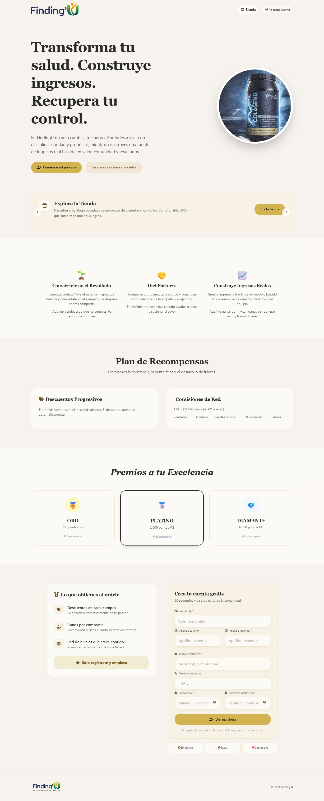
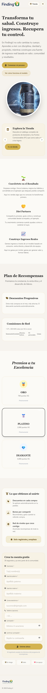

**Hallazgos**

1. **[Alta]** En la sección "Comisiones de Red" (desktop y sobre todo móvil) los encabezados de
   columna (`Generación`, `Comisión`, `Directos activos`, `PC personales`, `Líneas`) se
   comprimen sin espacio ni salto de línea entre sí — en móvil llegan a leerse pegados
   ("GeneraciónComisiónDirectosactivos..."), y en desktop la tabla no muestra ninguna fila de
   datos (solo cabecera), quedando como una tabla vacía sin contenido perceptible ni mensaje.
2. **[Media]** El bloque "Premios a tu Excelencia" (ORO/PLATINO/DIAMANTE) usa la etiqueta
   "Próximamente" en los tres niveles, pero visualmente uno de los tres (PLATINO) se resalta con
   un `ring`/borde oscuro grueso sin razón aparente (no hay estado "actual" o "seleccionado" que
   lo justifique) — confunde sobre qué representa ese énfasis.
3. **[Media]** El formulario "Crea tu cuenta gratis" no tiene mensajes de ayuda para el patrón de
   contraseña hasta que se envía; los inputs de contraseña muestran solo un icono de ojo sin
   indicador de fortaleza ni criterios visibles (mín. 8 caracteres se menciona como placeholder,
   no como texto de ayuda persistente accesible a lectores de pantalla).
4. **[Baja]** La imagen del producto en el héroe está recortada dentro de un círculo con mucho
   espacio negativo alrededor; en el mock no cargó (bug de datos de la captura, no del sistema),
   pero confirma que no hay ningún tratamiento visual (skeleton, blur-up, fondo con `bg-ambient`)
   para el estado de imagen ausente — solo queda el círculo vacío.
5. **[Baja]** Los tres micro‑badges finales ("Sin riesgo", "Gratis", "Con apoyo") usan `chip` con
   emoji inline en vez de icono `fa-*` como el resto de la página — pequeña inconsistencia de
   lenguaje visual (emoji vs. Font Awesome) que ya se repite en varias tarjetas de beneficios.

**Propuestas**

- Envolver la tabla de comisiones en `table-soft` (ya definida en `styles.css`, con
  `thead`/`tbody` estilizados) y forzar `overflow-x:auto` en el contenedor para móvil en vez de
  comprimir columnas; en el header usar `white-space: nowrap` + scroll horizontal, no
  wrap forzado.
- Quitar el `ring`/borde de PLATINO o, si representa "recomendado", agregar un `badge
  badge-active` con texto "Recomendado" para que el énfasis tenga significado explícito.
- Añadir un `<small class="text-gray-500">` fijo bajo el campo contraseña con la regla mínima,
  reutilizando la clase ya usada en `ui-form-field` (`text-xs text-danger` para error,
  `text-gray-500` para ayuda neutra).
- Unificar iconografía: reemplazar los emoji sueltos por `<i class="fa-solid fa-*">` con la misma
  paleta `icon-muted`/`icon-accent` que usa el resto del sistema.

---

## 2. Login (`/#/login`)

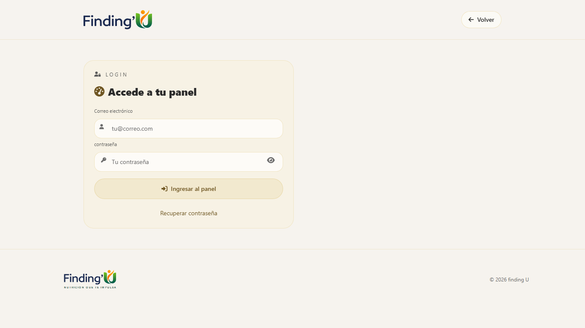
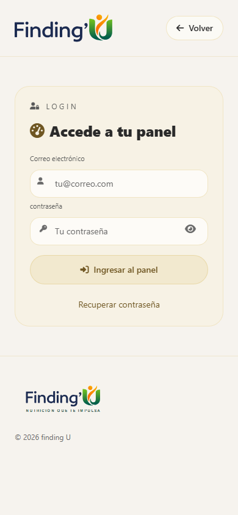

**Hallazgos**

1. **[Media]** La tarjeta de login queda anclada arriba-izquierda con un desktop de 1366px casi
   vacío a la derecha; no hay ilustración, mensaje de marca ni contexto — se siente como una
   pantalla incompleta más que una decisión de diseño (compárese con el equilibrio visual del
   Landing).
2. **[Media]** El microcopy de las etiquetas ("LOGIN", "Correo electrónico", "contraseña") mezcla
   mayúsculas/minúsculas de forma inconsistente: el eyebrow "LOGIN" está en versalitas, el label
   "Correo electrónico" en Sentence case, pero "contraseña" aparece en minúscula total sin
   capitalizar — rompe la jerarquía tipográfica esperada.
3. **[Baja]** El botón "Volver" y "Recuperar contraseña" usan el mismo nivel de énfasis visual
   (texto plano/ghost) que el link de soporte, sin distinguir la acción secundaria "salir del
   flujo" de la acción de recuperación, que es más relevante para quien tiene un problema real de
   acceso.
4. **[Baja]** No hay affordance de "mostrar/ocultar contraseña" resaltado (el icono de ojo es
   pequeño, bajo contraste `icon-muted` sobre fondo `surface-1`), dificultando su detección táctil
   en móvil (objetivo < 24px).

**Propuestas**

- Reutilizar el patrón de dos columnas del Landing (imagen/mensaje + formulario) o, si se
  mantiene el layout actual, centrar la tarjeta con `max-width` y agregar un panel lateral con
  `bg-ambient`/`grain` para no dejar el 60% del viewport vacío en desktop.
- Normalizar labels a Sentence case en toda la página (`Correo electrónico`, `Contraseña`).
- Diferenciar "Recuperar contraseña" con `btn-linkish` (ya definido) para que se perciba como
  acción, y dejar "Volver" como texto muted simple.
- Aumentar el hit-area del icono mostrar/ocultar a mínimo 44×44px con `padding`, manteniendo el
  icono visual pequeño dentro (patrón ya usado en otros inputs con icono, solo falta el padding
  del contenedor clicable).

---

## 3. Tienda (`/#/tienda`)

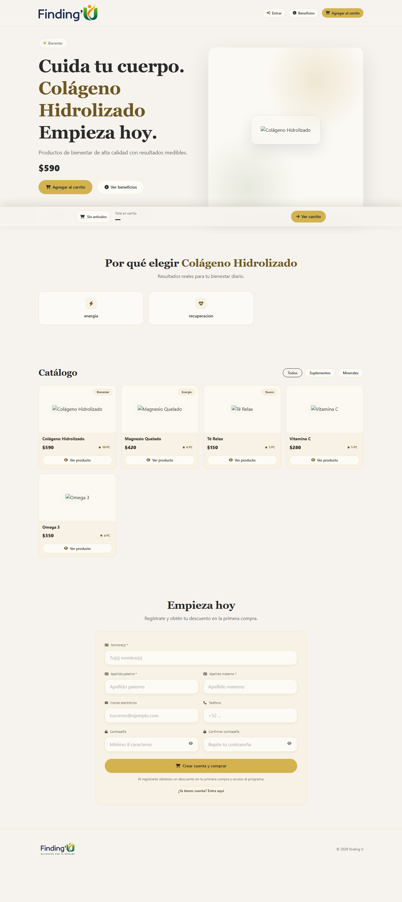
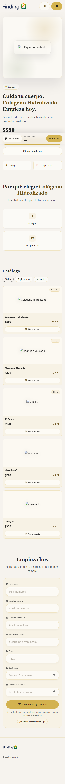

**Hallazgos**

1. **[Alta]** Cuando la imagen del producto no resuelve, no queda ningún placeholder visual: se
   ve el `alt` text roto ("​Colágeno Hidrolizado") flotando dentro de una caja vacía, tanto en el
   héroe como en cada `ui-product-card` del catálogo. No hay `background` neutro, icono de
   producto genérico ni `object-fit` con fallback.
2. **[Media]** La barra flotante "Sin artículos / Total en carrito — / Ver carrito" queda pegada
   inmediatamente debajo del héroe sin separación clara del resto de la página (incluso podría
   confundirse con parte del héroe); en scroll no queda claro si es sticky o estática.
3. **[Media]** Los filtros de categoría ("Todos", "Suplementos", "Minerales") son pills pequeños
   sin indicar cuántos productos hay por categoría, y el filtro activo ("Todos") tiene un
   contraste de borde muy sutil frente a los inactivos — cuesta distinguir cuál está seleccionado
   a primera vista.
4. **[Baja]** Cada `ui-product-card` repite precio, PC y botón "Ver producto" con el mismo peso
   visual que "Agregar al carrito" del héroe, sin jerarquía entre "producto destacado" (héroe) y
   "producto de catálogo" — todo compite al mismo nivel.
5. **[Baja]** El formulario de registro ("Empieza hoy") se repite casi idéntico al del Landing al
   final de la Tienda; en el mismo scroll ya se mostró antes el mismo copy y estructura, sin
   variación de estrategia (podría aprovechar el contexto de "ya viste el producto" con
   value prop distinto).

**Propuestas**

- Definir un placeholder estándar de imagen rota: contenedor `bg-sand-100` + icono
  `fa-image`/`fa-leaf` centrado en `icon-muted`, aplicado tanto en `ui-product-card` como en el
  héroe de producto — evita el `alt` text expuesto.
- Dar a la barra de carrito flotante un `surface-soft` con sombra más marcada (ya existe la clase)
  y `sticky top-0` explícito, para comunicar que persiste al hacer scroll.
- Resaltar el filtro activo con `btn-primary` en vez del estilo ghost actual que ya usan todos los
  pills, y opcionalmente mostrar el conteo `(n)` en cada pill usando `badge-compact`.
- Usar `btn-secondary` para "Ver producto" en las tarjetas de catálogo y reservar `btn-primary`
  ("Agregar al carrito") como la única acción dorada por tarjeta, reforzando cuál es la acción
  principal.

---

## 4. Carrito y checkout (`/#/carrito`)

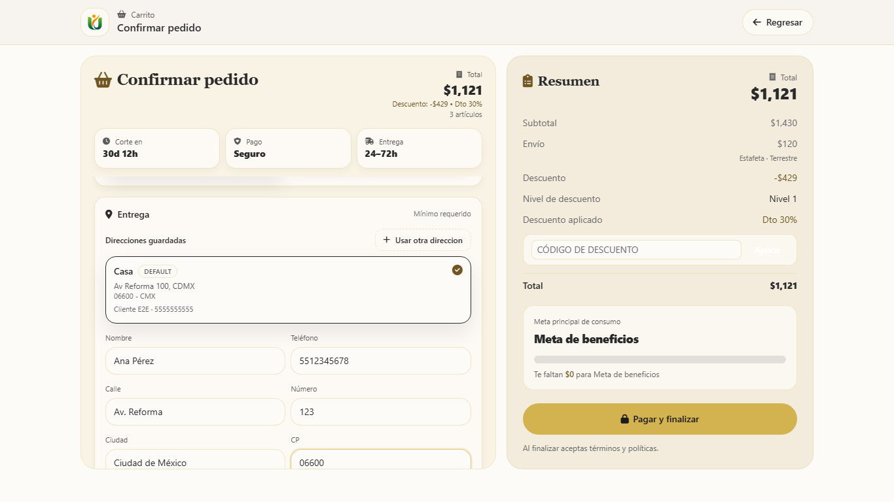
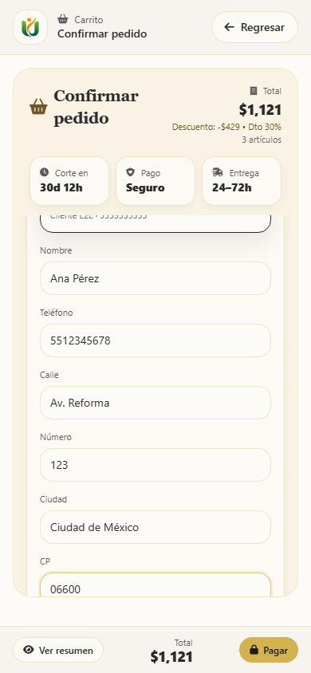

**Hallazgos**

1. **[Media]** El bloque de chips informativos ("Corte en 30d 12h", "Pago Seguro", "Entrega
   24–72h") usa el mismo tratamiento visual (`surface-soft`/`chip`) que las tarjetas de acción
   reales (direcciones, resumen), lo que dificulta distinguir "información pasiva" de "controles
   interactivos" a primer vistazo.
2. **[Media]** En móvil el resumen de pago (`Total $1,121` / botón `Pagar`) queda fijo abajo
   mientras el formulario de entrega se desplaza por encima; el usuario debe llenar seis campos
   (Nombre, Teléfono, Calle, Número, Ciudad, CP + selects de Estado/País) sin ver el resumen ni
   el CTA hasta hacer scroll — considerando que ya hay una barra fija inferior, sería el lugar
   natural para anclar avance/errores del formulario en vez de solo el total.
3. **[Media]** La tarjeta de "Direcciones guardadas" y los campos editables de abajo (Nombre,
   Teléfono, Calle...) están prellenados con los mismos datos de la dirección seleccionada, sin
   distinguir visualmente si el usuario está "usando la guardada" o "editando una copia" — no hay
   estado de solo-lectura ni mensaje que aclare la relación entre ambos bloques.
4. **[Baja]** El campo "Código de descuento" (visto en specs) no aparece en el viewport capturado
   sin scroll adicional — su ubicación no está anclada cerca del total, reduciendo su
   descubribilidad.
5. **[Baja]** "Meta de beneficios" dentro del resumen usa una barra de progreso en gris
   (`progress`/`progress-fill`) sin color de marca visible cuando el avance es 0% — se ve como
   una barra "rota" o deshabilitada en vez de "sin avance aún".

**Propuestas**

- Diferenciar chips informativos de controles: usar `chip` solo para info pasiva y reservar
  `surface-soft` + borde `border-olive-30` más grueso para tarjetas accionables (direcciones,
  tarifas de envío).
- En móvil, mostrar un resumen colapsado (subtotal + botón) sticky en la parte superior del
  formulario además del inferior, o convertir la barra inferior en un stepper con "Paso 2 de 3"
  para dar orientación sin scroll.
- Añadir un toggle explícito "Usar dirección guardada" vs. "Editar esta entrega" (`btn-ghost`
  activo/inactivo) en vez de dejar ambos bloques editables simultáneamente.
- Revisar que `.progress-fill` en 0% mantenga un tramo mínimo visible (`min-width` de 6-8px) con
  `rgba(var(--rgb-primary), 0.95)` para comunicar "en progreso, aún sin avance" en vez de vacío
  total.

---

## 5. Dashboard del asociado (`/#/dashboard`)

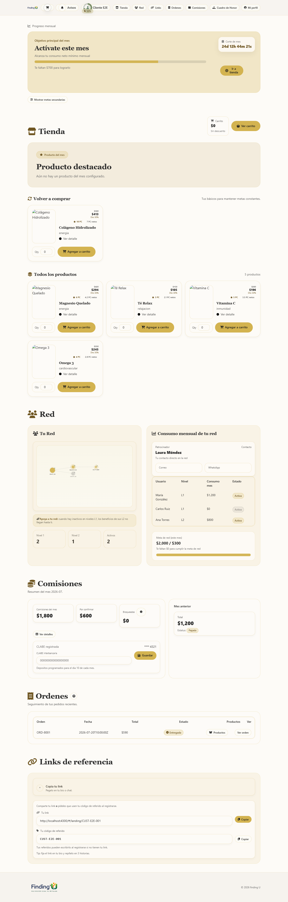
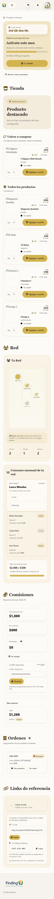

**Hallazgos**

1. **[Alta]** Es una única página con 8 secciones ancladas (`#merchant`, `#red`, `#volumen`,
   `#comisiones`, `#ordenes`, `#links`, `#honor`) de scroll muy largo (≈4270px desktop / ≈6320px
   móvil) sin ningún resumen tipo "at a glance" arriba: el usuario debe desplazarse mucho para
   encontrar comisiones o su red, aunque el nav superior sí enlaza a cada ancla (buen soporte,
   pero depende de que el usuario lo note).
2. **[Media]** La meta principal ("Actívate este mes") y la meta secundaria comparten la etiqueta
   genérica "Progreso mensual" arriba, pero el botón "Mostrar metas secundarias" está colapsado
   por defecto — dado que hay una meta de red activa relevante, ocultarla reduce su visibilidad
   inicial.
3. **[Media]** La sección "Tu Red" (mapa de nodos) ocupa una tarjeta grande pero en las capturas
   los nodos son minúsculos y sin leyenda de color/nivel visible dentro del propio canvas — hay
   que cruzar con la tabla de la derecha para entender qué representa cada nodo.
4. **[Media]** "Producto destacado" muestra el estado vacío "Aún no hay un producto del mes
   configurado" con el mismo tratamiento visual (`surface-soft` dorado) que el resto de tarjetas
   con contenido real — un estado vacío administrativo no debería tener el mismo peso visual que
   contenido accionable para el usuario.
5. **[Baja]** La tabla de "Tu Red" (María González / Carlos Ruiz / Ana Torres) usa un badge
   `Activa`/`Inactiva` en dorado para ambos casos con opacidades muy cercanas — en la captura es
   difícil diferenciar a simple vista cuál miembro está activo vs. inactivo.
6. **[Baja]** La sección "Links de referencia" repite el mismo layout de tarjeta `surface-soft`
   con dos botones "Copiar" idénticos (link y código) sin agrupar visualmente cuál es "para
   compartir en redes" vs. "para dar de viva voz".

**Propuestas**

- Agregar un resumen compacto de 3-4 `kpi-mini` (ya definida) fijo bajo el header con: comisiones
  del mes, meta activa (%), tamaño de red — para dar panorama sin scroll, antes de las secciones
  largas.
- Expandir por defecto la meta secundaria cuando esté activa (`achieved:false`, `locked:false`),
  reservando el colapso solo cuando hay 3+ metas.
- Usar `badge-inactive` (ya definida, gris neutro) para "Inactiva" y reservar `badge-active`
  (dorado) solo para "Activa", en vez de dos variantes doradas con distinta opacidad —
  actualmente ambas leen como "positivas".
- Dar al estado vacío de "Producto destacado" un tratamiento distinto: `callout` (clase ya
  definida, con fondo más neutro) en vez de la tarjeta dorada de producto real.

---

## 6. Perfil (`/#/perfil`)

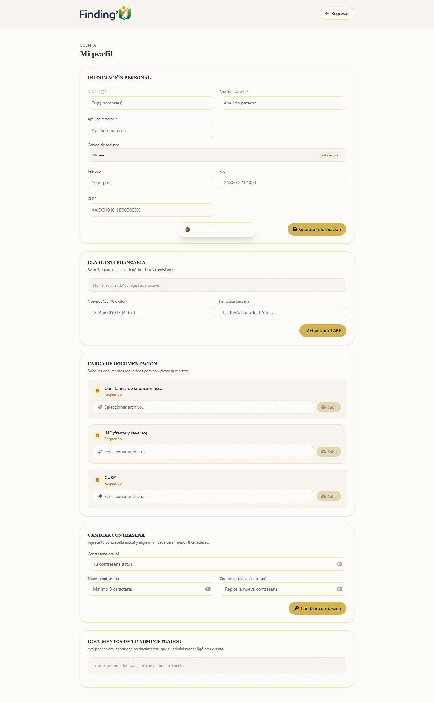

**Hallazgos**

1. **[Alta]** En móvil aparece un elemento (chip/indicador de confirmación con icono de check)
   superpuesto sobre la etiqueta del campo "CURP", tapándola parcialmente — es un bug visual de
   posicionamiento (probablemente un toast o badge de estado con `position: absolute` mal
   acotado a su contenedor) que en desktop se ve flotando correctamente debajo del botón
   "Guardar información" pero en móvil invade el campo siguiente.
2. **[Media]** Los 5 bloques de la página (Información personal, CLABE, Documentación, Cambiar
   contraseña, Documentos del administrador) usan la misma tarjeta blanca sin ninguna jerarquía
   de importancia — "Documentos de tu administrador" (mayormente vacío/informativo) pesa
   visualmente igual que "Cambiar contraseña" (acción sensible).
3. **[Media]** El campo "Correo de registro" está deshabilitado con badge "Solo lectura", pero el
   contraste de fondo (`bg-surface` gris muy claro) es casi idéntico al de los campos editables
   vecinos — la única señal de "no editable" es el badge de texto, no hay tratamiento visual
   fuerte (ej. `cursor: not-allowed`, icono de candado).
4. **[Baja]** Los 3 uploaders de documentos ("Constancia...", "INE...", "CURP") muestran el
   mismo estado "Seleccionar archivo..." sin indicar si son obligatorios de forma más prominente
   que la etiqueta roja "Requerido" en texto pequeño — fácil de pasar por alto en un formulario
   largo.
5. **[Baja]** No hay indicación de guardado exitoso persistente (solo un mensaje flotante
   temporal); si el usuario se distrae, no hay forma de confirmar después si guardó los cambios.

**Propuestas**

- Corregir el contenedor del indicador de confirmación para que use `position: relative` respecto
  a su propio botón (`Guardar información`) con `overflow` controlado, o convertirlo en un
  snackbar/toast global (ya existe patrón de `snackbar` en `admin.component.html`) en vez de un
  elemento posicionado dentro del formulario.
- Visualmente diferenciar tarjetas informativas de tarjetas de acción: usar `callout` para
  "Documentos de tu administrador" cuando está vacío, y mantener `surface-soft` solo en bloques
  con inputs editables.
- Aplicar un fondo más marcado (`bg-sand-100` o `--color-surface-3`) + `cursor-not-allowed` a los
  campos de solo lectura para reforzar el badge textual.
- Mover "Requerido" al lado del título del documento como `badge badge-pending` en vez de texto
  plano en color de alerta, consistente con el resto de badges del sistema.

---

## 7. Seguimiento de orden (`/#/orden/:idOrden`)

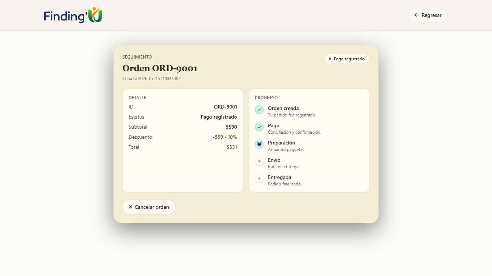
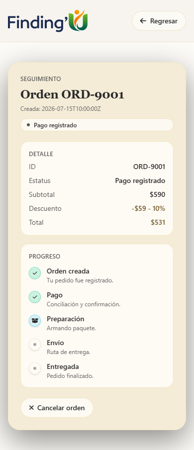

**Hallazgos**

1. **[Media]** Es de las pantallas mejor resueltas del sistema (jerarquía clara, timeline
   legible, buen uso de `surface-soft` y badges de paso), pero el botón "Cancelar orden" usa el
   mismo `btn-ghost` neutro que "Regresar" en el header — para una acción destructiva/irreversible
   no hay ninguna señal de peso o riesgo antes de hacer clic (ni color, ni ícono de alerta).
2. **[Media]** El paso activo del timeline ("Preparación") usa un icono de emoji (🐱 o similar,
   se ve un ícono de "gato"/mascota) que rompe el lenguaje de iconos Font Awesome usado en el
   resto del timeline (círculos con check / punto neutro) — visualmente desentona.
3. **[Baja]** El badge de estado superior ("Pago registrado") y el mismo texto repetido en el
   detalle ("Estatus: Pago registrado") son redundantes sin aportar información adicional en
   pantallas tan compactas.
4. **[Baja]** No hay CTA de "Pagar con MercadoPago" visible en el estado `paid` (correcto, ya no
   aplica), pero tampoco queda claro qué acción alternativa tiene el usuario más allá de
   "Cancelar" — por ejemplo, contacto a soporte o ver factura/comprobante.

**Propuestas**

- Cambiar "Cancelar orden" a un botón con acento de alerta: reutilizar el token
  `--color-danger` existente para un nuevo `btn-danger`/`btn-ghost-danger` (borde
  `rgba(180,83,60,.35)`, texto `text-danger`) siguiendo el mismo patrón que ya usan
  `btn-secondary`/`btn-ghost`.
- Sustituir el icono de "Preparación" por un ícono Font Awesome coherente (`fa-box-open` o
  `fa-boxes-packing`) para mantener consistencia con el resto del timeline.
- Eliminar la redundancia entre el badge superior y la fila "Estatus" del detalle, o darle a uno
  de los dos un rol distinto (ej. badge = estado resumido, detalle = fecha del último cambio).

---

## 8. Admin — Pedidos (`/#/admin`, vista Pedidos)

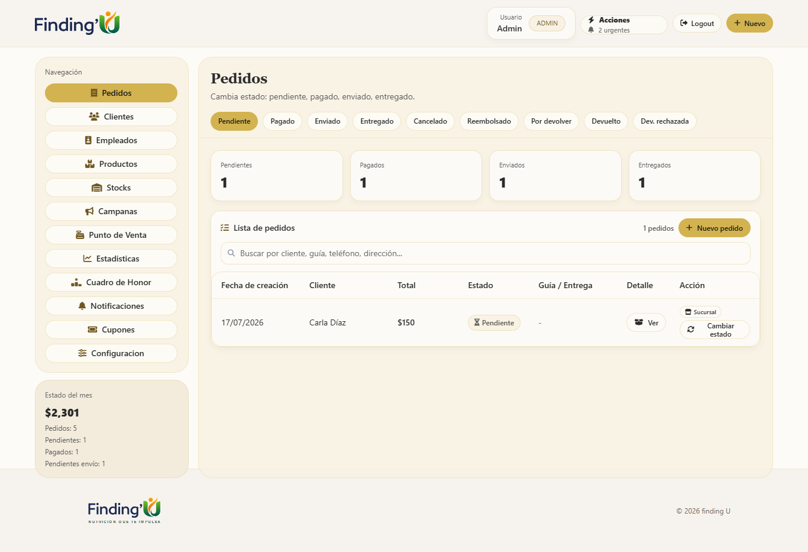
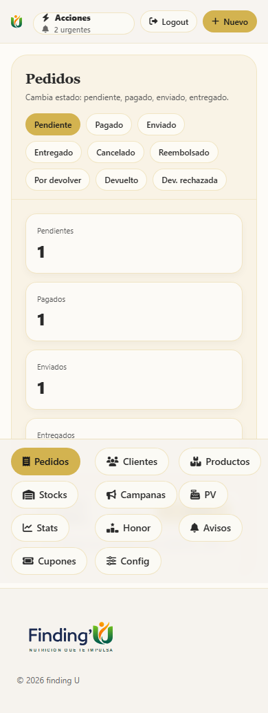

**Hallazgos**

1. **[Alta]** Los 9 filtros de estado ("Pendiente", "Pagado", "Enviado", "Entregado",
   "Cancelado", "Reembolsado", "Por devolver", "Devuelto", "Dev. rechazada") son pills con
   idéntico estilo dorado/neutro sin importar si el estado es positivo (Entregado), neutro
   (Pendiente) o negativo (Cancelado, Dev. rechazada) — no existe una variante `badge`/`btn` para
   estados de error en `src/styles.css` (`--color-danger` está definido pero no se usa en ningún
   badge o pill de estado; solo se usa para errores de formulario).
2. **[Media]** Las 4 tarjetas KPI (Pendientes/Pagados/Enviados/Entregados) muestran solo el
   conteo del filtro cargado en memoria, no el total real del mes — con el filtro "Pendiente"
   activo, cambiar a otra pestaña recarga toda la vista visualmente (parpadeo de KPIs en 0) en
   vez de mantenerlos estables mientras solo cambia la tabla.
3. **[Media]** La barra de búsqueda ("Buscar por cliente, guía, teléfono, dirección...") no tiene
   ningún filtro adicional visible (rango de fechas, canal de venta) pese a que el admin maneja
   pedidos de meses distintos — para operación diaria esto obliga a scrollear/buscar texto exacto.
4. **[Baja]** La columna "Guía / Entrega" muestra un guion "-" cuando no hay guía, sin distinguir
   si es porque el pedido es "pickup" (no aplica) o porque falta capturar el número de guía de un
   envío ya despachado — mismo símbolo para dos situaciones distintas.

**Propuestas**

- Añadir variantes `badge-danger`/`btn-ghost-danger` usando el token `--color-danger` ya
  declarado en `:root`, y aplicarlas a "Cancelado", "Devuelto" y "Dev. rechazada"; mantener
  `badge-active`/dorado para "Entregado"/"Pagado" y un tono neutro (`badge-inactive`) para
  "Pendiente"/"Por devolver".
- Separar la fuente de datos de los KPI de cabecera del filtro de tabla activo (cargar los 4
  conteos una sola vez con el total del mes, no recalcular sobre el subconjunto filtrado).
- Agregar un selector de rango de fechas simple (usando el mismo `ui-form-field kind="select"` o
  date-range ya usado en Estadísticas) junto al buscador.
- Reemplazar el guion por dos textos distintos: "No aplica (recolección)" vs. "Pendiente de
  guía" según `deliveryType`.

---

## 9. Admin — Clientes (`/#/admin`, vista Clientes)

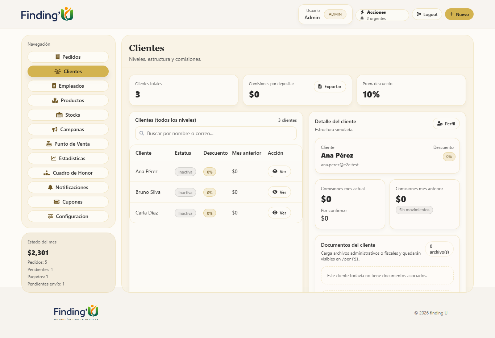
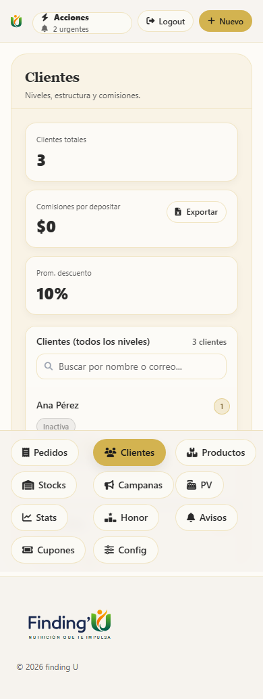

**Hallazgos**

1. **[Media]** Los tres clientes de ejemplo aparecen todos con badge "Inactiva" y "0%" de
   descuento aun cuando el mock incluye clientes con `orderCount` y `netTotal` reales — sugiere
   que el estado "activo/inactivo" en esta tabla depende de un cálculo mensual distinto al de
   pedidos/consumo, sin que la tabla lo explique (falta un tooltip o nota "activo = compró este
   mes").
2. **[Media]** El panel "Detalle del cliente" a la derecha solo se llena al hacer clic en "Ver";
   por defecto queda vacío ("Estructura simulada." + placeholders "Sin datos para mostrar") — es
   un espacio grande (≈40% del ancho) sin utilidad hasta la primera interacción, en vez de
   mostrar el primer cliente por defecto o un estado vacío más compacto.
3. **[Baja]** El texto "Mock. En producción: pintar con datos reales." es un comentario de
   desarrollo visible en producción dentro del panel de estructura — debe retirarse o
   condicionarse a un modo debug antes de release.
4. **[Baja]** "Comisiones por depositar" y "Prom. descuento" comparten formato de tarjeta KPI con
   "Clientes totales", pero uno es un monto operativo urgente (dinero por pagar) y merece más
   énfasis que un promedio informativo — incluso podría vivir junto a los avisos ("Acciones — N
   urgentes") del header.

**Propuestas**

- Agregar un tooltip/`title` en el header "Estatus" de la tabla aclarando el criterio de
  actividad usado, o renombrar la columna a "Activo este mes" para que sea autoexplicativa.
- Precargar el primer cliente de la lista en el panel de detalle al entrar a la vista, para que el
  espacio nunca se muestre completamente vacío en el primer render.
- Eliminar el string de desarrollo `"Mock. En producción: pintar con datos reales."` del template
  (`admin.component.html`) o envolverlo en un flag de entorno.
- Destacar "Comisiones por depositar" con `kpi-warn` (clase ya definida) cuando el monto sea > 0,
  en vez del mismo `kpi-mini` neutro que el resto.

---

## 10. Admin — Catálogo / Productos (`/#/admin`, vista Productos)

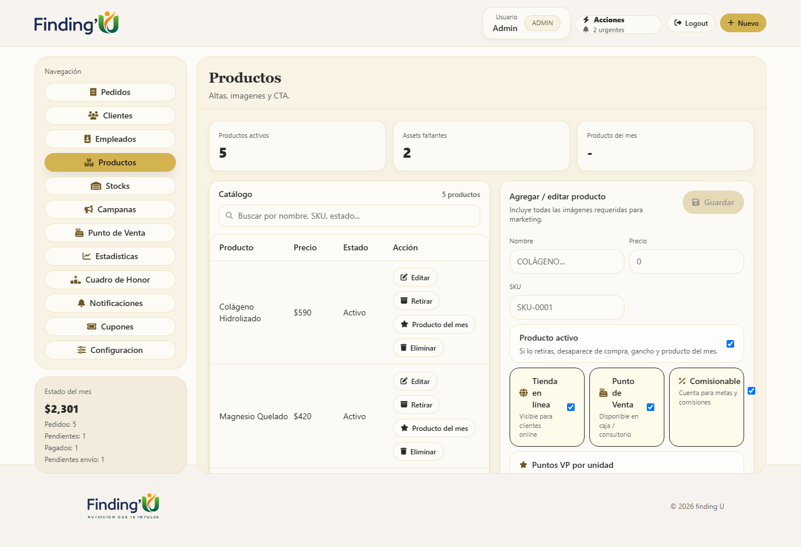
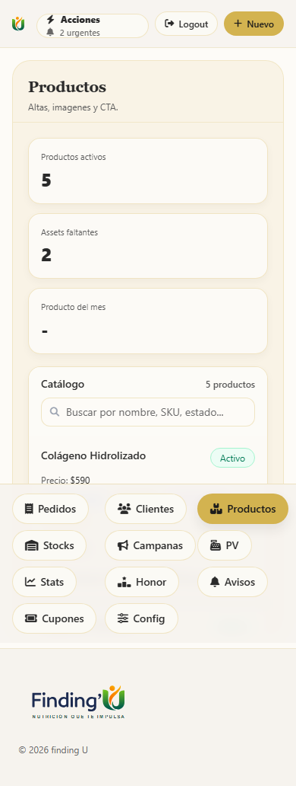

**Hallazgos**

1. **[Media]** Cada fila de producto en la lista despliega 4 botones de acción apilados
   verticalmente ("Editar", "Retirar", "Producto del mes", "Eliminar") en vez de un menú
   compacto — con 5+ productos la tabla se alarga mucho más de lo necesario y "Eliminar" (acción
   destructiva) queda al mismo nivel visual que las demás, sin distinción de riesgo.
2. **[Media]** El formulario "Agregar / editar producto" y la lista conviven en dos columnas de
   ancho similar (50/50); en la práctica el formulario tiene muchos más campos (Nombre, Precio,
   SKU, 3 checkboxes de canal, VP por unidad y más abajo, fuera de la captura) que la lista
   visible — el balance de columnas no refleja la carga de contenido real de cada una.
3. **[Baja]** Las tres tarjetas de canal ("Tienda en línea", "Punto de Venta", "Comisionable")
   usan checkboxes alineados a la derecha de cada tarjeta con texto descriptivo largo — en móvil
   compiten por espacio y podrían resolverse como simples toggles con label corto + tooltip.
4. **[Baja]** El KPI "Assets faltantes: 2" no indica qué producto ni qué asset falta desde esta
   vista — obliga a entrar producto por producto para descubrirlo.

**Propuestas**

- Colapsar las acciones de fila en un menú `⋮` (dropdown) reutilizando el patrón de acciones que
  ya usa "Acciones" del header admin, dejando visible solo "Editar" y moviendo
  "Retirar"/"Eliminar" al menú secundario con `text-danger` para "Eliminar".
- Redistribuir el grid a `lg:grid-cols-[1fr_1.3fr]` (o similar) dando más ancho al formulario, que
  concentra más campos que la lista.
- Simplificar las tarjetas de canal a un `chip` con checkbox inline + icono, dejando el texto
  descriptivo como `title`/tooltip en vez de párrafo fijo.
- Hacer clicable el KPI "Assets faltantes" para filtrar la lista por productos con assets
  incompletos.

---

## 11. Admin — Punto de Venta (`/#/admin`, vista PV)

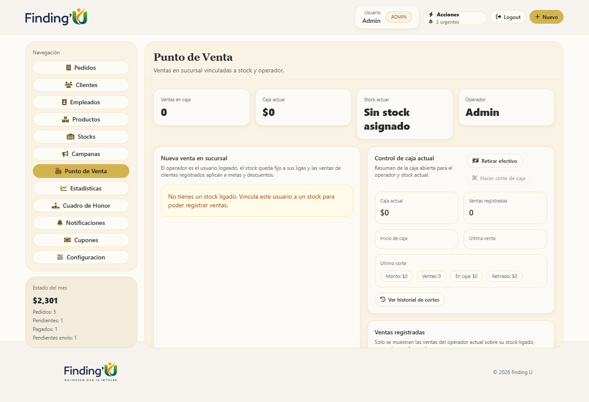
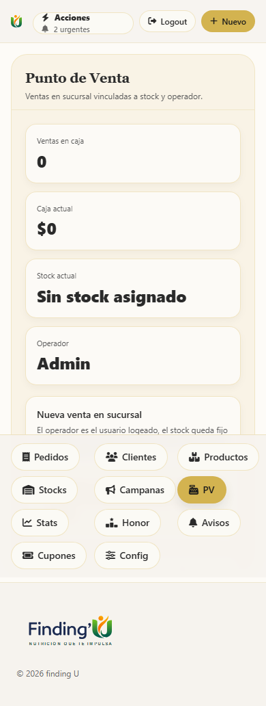

**Hallazgos**

1. **[Alta]** El estado "Sin stock asignado" bloquea toda la vista (no se puede vender) pero el
   mensaje de ayuda ("Vincula este usuario a un stock para poder registrar ventas") no incluye
   ningún acceso directo a la pantalla donde resolverlo (Stocks/Empleados) — es un callejón sin
   salida dentro del propio flujo.
2. **[Media]** Las 4 tarjetas KPI superiores ("Ventas en caja", "Caja actual", "Stock actual",
   "Operador") mezclan datos operativos (caja, ventas) con datos de contexto fijo (operador
   actual) al mismo nivel — "Operador: Admin" no cambia durante el turno y no debería competir
   visualmente con las cifras que sí varían.
3. **[Baja]** "Control de caja actual" repite varias etiquetas ya mostradas arriba ("Caja actual",
   "Ventas registradas") dentro de su propia tarjeta, generando redundancia entre el bloque de
   KPIs y el bloque de control de caja inmediatamente debajo.

**Propuestas**

- Cuando `Stock actual = "Sin stock asignado"`, mostrar un botón directo "Ir a Empleados" o
  "Ir a Stocks" (`btn-secondary`) junto al mensaje de ayuda, en vez de solo texto informativo.
- Mover "Operador" fuera de la fila de KPIs numéricos hacia el header de la sección (junto al
  título "Punto de Venta"), dejando la fila de KPIs solo para cifras de caja/ventas.
- Eliminar la duplicación entre KPIs superiores y "Control de caja actual", consolidando en un
  único bloque de cifras.

---

## 12. Admin — Configuración (`/#/admin`, vista Configuración)

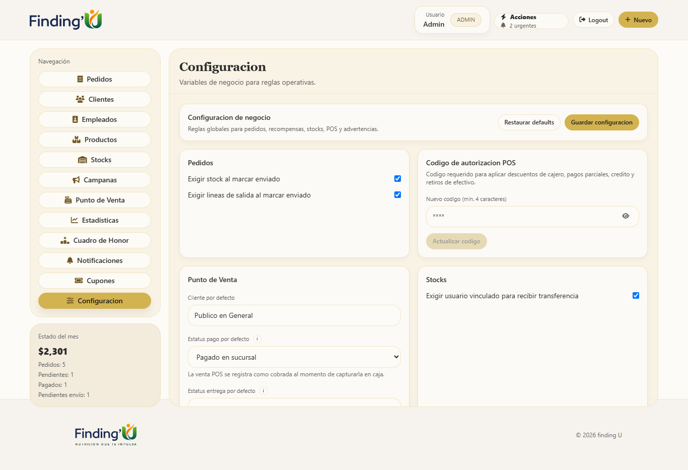
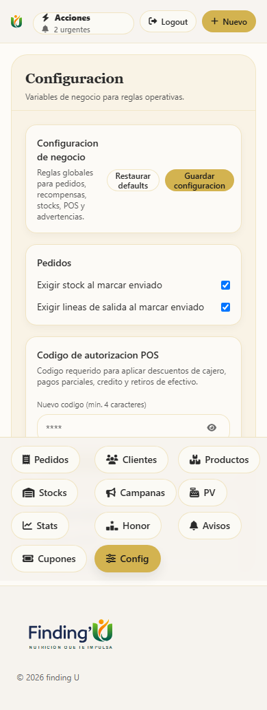

**Hallazgos**

1. **[Alta]** Es la vista con más densidad de controles de todo el sistema (reglas de pedidos,
   código de autorización POS, configuración de canal POS, stocks, y —fuera del viewport
   capturado— tiers de descuento, niveles de comisión, tipos de documento y bonos), pero no tiene
   ningún sub-navegación interna (tabs/acordeón): todo vive en un scroll largo dentro de la misma
   vista "Configuracion", dificultando ubicar una regla específica.
2. **[Media]** El campo "Nuevo código (mín. 4 caracteres)" para autorización POS usa un input de
   texto plano con icono de ojo (como si fuera contraseña) pero no se indica si el valor actual
   ya configurado se puede consultar o solo sobrescribir — no hay estado "código ya configurado"
   visible.
3. **[Media]** Los checkboxes ("Exigir stock al marcar enviado", "Exigir líneas de salida...",
   "Exigir usuario vinculado para recibir transferencia") no tienen texto de ayuda sobre las
   consecuencias de desactivarlos — son reglas operativas críticas (afectan si un pedido puede
   marcarse enviado) presentadas igual que cualquier checkbox trivial.
4. **[Baja]** El botón "Guardar configuración" es único para todo el formulario extenso; si el
   usuario solo quiere cambiar una sección (ej. solo Stocks), igual debe enviar todo el payload
   sin feedback de qué sub-sección cambió.

**Propuestas**

- Introducir tabs internas o acordeones (`Pedidos`, `POS`, `Stocks`, `Recompensas`, `Bonos`,
  `Documentos`) dentro de la vista Configuración, usando el mismo patrón de pills que ya existe
  en Pedidos (filtros de estado) para no crear un componente nuevo.
- Agregar un indicador "Código configurado" (`badge-active`) junto al campo cuando ya exista un
  valor guardado, y dejar el input vacío solo para *nuevo* valor (no mostrar el actual por
  seguridad, pero sí confirmar que existe).
- Añadir `small.text-gray-500` bajo cada checkbox crítico explicando el impacto operativo (ej.
  "Si se desactiva, los pedidos podrán marcarse como enviados sin capturar stock").
- Mantener el guardado único pero resaltar (borde `border-olive-70`) la sub-sección recién
  modificada tras un cambio, como confirmación visual de "esto es lo que se va a guardar".

---

## Hallazgo transversal: navegación admin en móvil

**[Alta, severidad más alta de todo el análisis]** El panel admin no tiene equivalente móvil del
menú lateral (`<aside class="hidden ... lg:flex">`, `admin.component.html:48`). En su lugar usa
una barra inferior fija (`#bottomBar`, `admin.component.html:4204`, `class="... lg:hidden"`) con
los 11 destinos de navegación en una grilla de 3 columnas × 4 filas. En viewport 390×844 esa
barra ocupa **~350px de alto fijos (≈41% del viewport)**, permanentemente superpuesta al
contenido: cualquier vista admin en móvil pierde casi la mitad de la pantalla útil todo el tiempo,
y el panel de contexto "Estado del mes" (visible en el `<aside>` de desktop) desaparece por
completo en móvil sin ningún sustituto.

Esto contrasta con el patrón ya resuelto en el Dashboard del asociado
(`user-dashboard.component.html:4-16`), que sí colapsa su navegación en un botón hamburguesa +
panel flotante (`ui-sidebar-nav` con `[compact]="true"`) — el mismo componente/patrón podría
reutilizarse en Admin en vez de la barra fija de 11 botones.

**Propuesta:** reemplazar `#bottomBar` en móvil por el mismo patrón hamburguesa + `ui-sidebar-nav`
compacto que ya usa `user-dashboard.component.html`, liberando el espacio fijo para contenido y
dando acceso a los 11 destinos vía un panel desplegable en vez de una grilla siempre visible.

---

## Top 10 de mejoras priorizadas (impacto / esfuerzo, transversales)

| # | Mejora | Pantallas afectadas | Severidad | Esfuerzo estimado |
|---|--------|----------------------|-----------|--------------------|
| 1 | Reemplazar la barra inferior fija de Admin (`#bottomBar`, 11 botones) por hamburguesa + `ui-sidebar-nav` compacto, como ya existe en el Dashboard | Todas las vistas admin en móvil (8-12) | Alta | Media |
| 2 | Crear variante `badge-danger`/`btn-ghost-danger` con el token `--color-danger` ya definido y aplicarla a estados negativos (Cancelado, Devuelto, Dev. rechazada, Cancelar orden) | Admin Pedidos, Order Status, Dashboard Comisiones | Alta | Baja |
| 3 | Placeholder estándar para imágenes rotas/ausentes (`bg-sand-100` + icono `fa-image`) en `ui-product-card` y héroes de producto | Landing, Tienda, Dashboard (Tienda embebida) | Alta | Baja |
| 4 | Corregir el elemento superpuesto sobre el campo CURP en Perfil móvil (bug de posicionamiento) | Perfil | Alta | Baja |
| 5 | Reparar/rediseñar la tabla "Comisiones de Red" del Landing (vacía en desktop, columnas ilegibles en móvil) con `table-soft` + scroll horizontal | Landing | Alta | Media |
| 6 | Añadir resumen `kpi-mini` fijo arriba del Dashboard (comisiones, meta activa, tamaño de red) para reducir dependencia del scroll de 4270-6320px | Dashboard | Media | Media |
| 7 | Diferenciar `badge-active`/`badge-inactive` de forma consistente (actualmente ambos estados de "Red" usan tonos dorados casi idénticos) | Dashboard, Admin Clientes | Media | Baja |
| 8 | Agregar botón de acceso directo desde el estado vacío "Sin stock asignado" (POS) hacia Empleados/Stocks | Admin POS | Alta | Baja |
| 9 | Introducir sub-navegación (tabs/acordeón) dentro de Admin Configuración, la vista más densa del sistema | Admin Configuración | Media | Media |
| 10 | Retirar el string de desarrollo `"Mock. En producción: pintar con datos reales."` visible en Admin Clientes | Admin Clientes | Baja | Baja |

---

## Inconsistencias sistémicas

- **Espaciados**: las tarjetas `surface-soft`/`kpi-mini` usan paddings y `border-radius`
  consistentes entre sí, pero el *ritmo vertical entre secciones* varía: el Dashboard separa
  secciones con márgenes grandes y títulos `h2` claros, mientras que Admin apila tarjetas KPI y
  bloques de formulario con menos aire entre ellos, sintiéndose más denso sin que exista una
  razón de contenido (ambas usan la misma familia de tokens de superficie).
- **Botones**: la guía (`guia-diseno-styles.md`) indica "no hardcodear... usar `btn`/variantes
  globales", y en la práctica los botones primarios/ghost sí siguen el sistema, pero **no existe
  ninguna variante de botón para acciones destructivas** (cancelar orden, eliminar producto,
  retirar). Todas usan `btn-ghost` o `btn-secondary` neutro, igual que acciones benignas —
  inconsistente con la severidad real de la acción.
- **Badges de estado**: el sistema define `badge-active`, `badge-inactive`, `badge-pending` y
  `level-1..5`, pero ningún estado usa el color `--color-danger` ya declarado en `:root`. Estados
  claramente negativos (Cancelado, Rechazado, Devuelto, Bloqueado) heredan la misma paleta
  dorada/neutra que estados positivos o neutros, perdiendo la señal de alerta que el propio
  sistema de tokens ya soporta.
- **Modales**: la guía pide usar `ui-modal` con `panelClass`/`containerClass` en vez de crear
  shells nuevos; no se detectaron shells alternos en las pantallas auditadas, pero el modal de
  registro guest en Carrito y el de confirmación en Admin no comparten el mismo patrón de
  cabecera/footer de acciones (uno centra el CTA principal, otro lo alinea a la derecha) — vale
  una pasada de consistencia dedicada sobre `ui-modal` en un análisis de componentes aparte.
- **Tablas**: `table-soft` está bien definida y se usa en Admin, pero convive con listas de
  "tarjeta por fila" (Admin Productos) que no son tablas reales — mismo tipo de dato (listado
  tabular), dos patrones visuales distintos dentro del mismo panel admin.
- **Estados vacíos**: no hay un componente/clase única para "vacío" en todo el sistema. Se
  observan al menos tres tratamientos distintos: texto centrado plano (`Sin resultados.` en
  tablas admin), tarjeta `surface-soft` completa reutilizando el estilo de contenido real
  ("Aún no hay un producto del mes configurado" en Dashboard), y placeholder con borde punteado
  implícito (Perfil, "Tu administrador todavía no te compartió documentos."). Vale estandarizar
  un `.empty-state` sobre `callout` para los tres casos.

## Quick wins de accesibilidad

1. **Contraste de badges/estado**: varios badges dorados sobre fondo `surface-2`/`surface-3`
   (ej. "Activa"/"Inactiva" en Dashboard Red, "Pendiente" en Admin) usan variaciones de opacidad
   de `--rgb-primary` (0.14 a 0.22) que quedan muy cerca del umbral WCAG AA para texto pequeño —
   validar con una herramienta de contraste y, donde falle, subir la opacidad del texto
   (`--text-on-primary`) o el peso de fuente en vez de solo el fondo.
2. **Icono mostrar/ocultar contraseña**: en Login y Registro el icono de ojo no tiene `aria-label`
   evidente ni área táctil de 44×44px — agregar `aria-label="Mostrar contraseña"` dinámico
   (`Mostrar`/`Ocultar` según estado) y padding al botón contenedor.
3. **Imágenes rotas sin alt tratado**: cuando el `src` de producto falla, el texto `alt` queda
   expuesto sin rol ni contexto adicional — además del placeholder visual (ver mejora #3),
   asegurar que el `alt` describa el producto ("Foto de Colágeno Hidrolizado") para lectores de
   pantalla incluso cuando la imagen carga correctamente (verificar que no esté vacío `alt=""` en
   ningún `ui-product-card`).
4. **Foco visible en pills/filtros**: el sistema ya define `:focus-visible` global con
   `outline: 2px solid rgba(var(--rgb-primary), 0.85)`, pero varios pills (`chip`, filtros de
   categoría/estado) parecen `<button>` envueltos por `ui-button` — verificar que el foco de
   teclado no quede oculto detrás de `border-radius: 9999px` con `overflow:hidden` en algún
   contenedor padre.
5. **Botón "Cancelar orden" y acciones destructivas**: además de la falta de color de alerta
   (mejora #2), agregar confirmación con `aria-describedby` explicando la consecuencia antes de
   ejecutar, no solo un modal genérico "¿Confirmar?".
6. **Bottom bar admin en móvil**: al ocupar ~41% del viewport de forma permanente, reduce el área
   utilizable por debajo de los mínimos recomendados de contenido visible por scroll — más allá
   de la mejora de UX (rediseño #1), desde accesibilidad motriz esto también fuerza más scroll del
   necesario para usuarios con movilidad reducida en el pulgar/mano.
7. **Tamaño táctil en tablas admin densas** (Pedidos, Productos): los botones de acción por fila
   ("Editar", "Retirar", "Producto del mes", "Eliminar") se ven con padding ajustado en desktop;
   validar en móvil (cuando la tabla se convierte en `mobileRow`, ver `mobileDividerClass` en
   `admin.component.html:162`) que cada acción mantenga ≥44px de alto, no solo ancho completo.

---

## Notas metodológicas

- Todas las capturas usan datos **mockeados** vía `page.route()` sobre `API_BASE`, replicando los
  shapes ya validados por `e2e/support/dashboard-mocks.ts` y `e2e/support/admin-mocks.ts` (no se
  modificó ningún archivo de `e2e/`). El script vive en `docs/ux/capture-screens.js` y no requiere
  el test runner de Playwright (usa `chromium.launch()` directo), evitando el problema de
  `testDir` de `playwright.config.ts`.
- Las imágenes de producto rotas visibles en varias capturas (Landing, Tienda, Dashboard) son un
  artefacto del entorno de captura (rutas relativas `images/*.png` sin servir localmente) y no
  necesariamente reflejan un bug de producción — se documentan igualmente porque exponen la
  ausencia de un tratamiento de *fallback* visual, que sí es un hallazgo de diseño válido
  independientemente de la causa raíz de la imagen faltante en este entorno.
- La vista Admin → Punto de Venta se capturó con un usuario `admin-001` (superusuario) sin stock
  vinculado, lo que produjo intencionalmente el estado vacío "Sin stock asignado" documentado en
  la sección 11; es un estado real y alcanzable en producción (cualquier admin/empleado sin
  `stockId` asignado lo vería), no un artefacto del mock.

---

## Implementado 2026-08-01

Ciclo de implementación sobre este análisis. Build (`npm run build`) OK; suite E2E completa en
verde: **208/208** (205 preexistentes + 3 nuevas). Capturas "después" en `docs/ux/img/after-*.png`
(mismo set de 12 pantallas × 2 viewports que las originales, regeneradas con
`SHOT_PREFIX=after- node docs/ux/capture-screens.js`).

### Alta (mínimo requerido)

| Ítem | Archivos principales | Cambio |
|---|---|---|
| (a) Navegación admin móvil | `admin.component.html`, `admin.component.ts`, `ui-header.component.ts/html` | Se eliminó `#bottomBar` (barra fija de 11-12 botones, ~41% del viewport) y se reemplazó por hamburguesa + `ui-sidebar-nav[compact]` flotante, mismo patrón que `user-dashboard.component.html`. Incluye sustituto móvil del panel "Estado del mes" (antes solo en el `<aside>` de desktop). De paso se corrigió un bug de stacking-context real (`backdrop-filter` sin `position`+`z-index` propios en `<header>` dejaba cualquier dropdown interno inclickeable detrás del contenido) y un colapso de ancho (el grupo de acciones con `min-w-[148px]` fijo + el nuevo hamburguesa no cabían en 390px). |
| (b) Variante danger para estados negativos | `styles.css`, `ui-badge.component.ts`, `ui-button.component.ts/html`, `ui-status-badge.component.ts`, `order-status.component.html/ts` | Nuevos tokens `--rgb-danger`/`--text-on-danger` y clases `badge-danger`/`btn-ghost-danger` sobre `--color-danger` (ya declarado, sin usar). `ui-status-badge` ahora reconoce `cancelled`/`devuelto_validado`/`devolucion_rechazada` (antes cualquiera de estos caía en el tono neutro por defecto, o incluso mostraba el valor crudo en inglés) y les aplica `tone="danger"`; se corrigió además un bug de especificidad CSS por el que la clase `level-N` siempre pintaba encima del tono. Aplica automáticamente en Admin Pedidos y Dashboard (ambos ya usaban `ui-status-badge`). Botón "Cancelar orden" → `variant="danger"` + `aria-describedby`. |
| (c) Overlay sobre CURP en Perfil móvil | `user-profile.component.html` | El toast de confirmación (`fixed`) se reancló de `bottom-6` a `top-20` (con `role="status" aria-live="polite"` agregado). En viewports mobile bajos, un toast anclado abajo podía caer sobre el último campo visible del formulario; anclado arriba, bajo el header, nunca coincide con campos del formulario. |
| (d) Placeholder de imagen rota/ausente | `directives/img-fallback.directive.ts` (nuevo), `ui-product-card`, `landing`, `tienda`, `user-dashboard` | Directiva `[imgFallback]` reutilizable: en `(error)` sustituye el `src` por un SVG inline (ícono + fondo `bg-sand-100`) vía clase `.img-fallback`, conservando el `alt` original para lectores de pantalla. Aplicada en las 8 imágenes de producto de la app (héroe de Landing/Tienda, `ui-product-card` en sus dos modos, héroe de "Producto destacado" y modal de detalle del Dashboard). |
| (e) Tabla "Comisiones de Red" (Landing) | `landing.component.html` | Envuelta en `table-soft` + `overflow-x-auto` con `min-w-[560px]` y `whitespace-nowrap` en vez de comprimir columnas; agregado estado vacío defensivo (`empty-state`) para el caso de 0 niveles configurados. |

### Top 10 (resto, no cubierto arriba)

| # | Ítem | Archivos | Cambio |
|---|---|---|---|
| 6 | Resumen `kpi-mini` fijo en Dashboard | `user-dashboard.component.html` | 3 `ui-kpi-card` (Comisiones del mes, Meta activa %, Tamaño de tu red) antes de las secciones largas, sin scroll. |
| 7 | Consistencia badge-active/inactive | `styles.css` | La lógica de tono ya distinguía Activa/Inactiva correctamente (orden `'inact'` antes que `'activa'`, ya con fix previo). El contraste de texto sí era insuficiente (`rgba(--rgb-text, .45-.58)` ≈ 2.6:1, bajo AA): se reemplazó por `--color-text-muted` sólido (~4.5:1) en `badge-inactive`, `.badge.status-inactive` y `.badge.level-5`. |
| 8 | Acceso directo desde "Sin stock asignado" (POS) | `admin.component.html` | Botón "Ir a Empleados" (o "Ir a Stocks" si no hay permiso de empleados) junto al mensaje, en vez de un callejón sin salida. |
| 9 | Sub-navegación en Admin Configuración | `admin.component.html`, `admin.component.ts` | Se optó por un índice de pills con scroll suave (`scrollToConfigSection()`) a 6 anclas (Pedidos/POS/Stocks/Documentos/Bonos/Recompensas) en vez de tabs con show/hide — ver "Descartado" abajo. |
| 10 | String de desarrollo en Admin Clientes | `admin.component.html` | Se eliminó `"Mock. En producción: pintar con datos reales."` del template. |

### Quick wins de accesibilidad

1. **Contraste de badges**: cubierto arriba (ítem 7).
2. **Icono mostrar/ocultar contraseña**: `aria-label`/`title` dinámicos ya existían en `ui-form-field` y `login`; se agregó a los 3 campos de Perfil (antes sin ningún `aria-label`). Área táctil ampliada a 44×44px (`h-11 w-11`) en los 4 puntos donde aparece este control (`ui-form-field`, login, perfil ×3).
3. **Alt text en imágenes de producto**: verificado — ningún `ui-product-card` usa `alt=""`; todos usan `[alt]="product.name"`. Sin cambios necesarios.
4. **Foco visible en pills/filtros**: revisado en los contenedores `overflow-hidden` de la app; el único caso real de recorte era el carrusel de Landing (`overflow-hidden` + botones `absolute` cerca del borde) — se corrigió con `outline-offset:-2px` en esos dos botones, que de paso se ampliaron a 44×44px.
5. **"Cancelar orden" con confirmación explicada**: cubierto arriba (ítem b) — se agregó `aria-describedby` con el texto de consecuencia (`ui-button` ahora reexpone `aria-describedby` del host al `<button>` real, mismo patrón que ya existía para `aria-label`); la navegación a `/orden/:id/cancelar` ya era en sí un paso de confirmación dedicado.
6. **Bottom bar admin en móvil**: cubierto arriba (ítem a).
7. **Tamaño táctil en tablas admin densas**: `min-h-11` agregado a los botones de acción de la fila móvil en Admin Pedidos (Ver detalle/Cambiar estado/Entregar en sucursal) y Admin Productos (Editar/Retirar/Producto del mes/Eliminar).

### Bonus (bajo riesgo, alta cercanía con lo anterior)

- Texto de ayuda persistente "Mínimo 8 caracteres." bajo el campo de contraseña del registro (Landing/Tienda comparten el mismo `#formBlock`).
- Normalizado el label "contraseña" → "Contraseña" en Login (Sentence case).
- "Eliminar producto" (Admin Catálogo, fila y modal de confirmación) migrado de rojo Tailwind hardcodeado (`text-red-600`, `hover:text-red-600`) a `text-danger-deep`/`variant="danger"` del sistema de diseño.
- `order-status.component.ts`: `statusClass` migrado de colores Tailwind hardcodeados (`border-red-400/30 bg-red-500/10`, etc.) a `badge-danger` para estados negativos; se corrigió además un bug de cascada preexistente (la clase estática `border-olive-30 bg-ivory-80` del badge de estado, declarada después en `styles.css`, siempre ganaba sobre las clases condicionales — el badge se veía igual sin importar el estado real de la orden).

### Capturas "después"

Set completo en `docs/ux/img/after-*.png` (mismo naming que las originales, prefijo `after-`).
Selección de las pantallas con cambios más visibles:

**Admin — Pedidos, móvil** (sin `#bottomBar`, hamburguesa + panel flotante en el header):

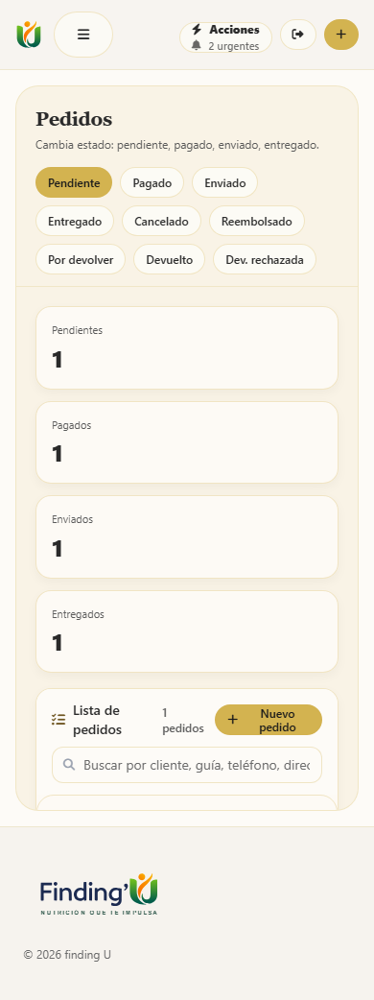

**Landing, móvil** (tabla "Comisiones de Red" legible con scroll horizontal):

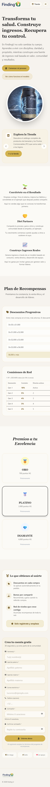

**Tienda, desktop** (placeholder de imagen en héroe y catálogo, en vez de `alt` roto):

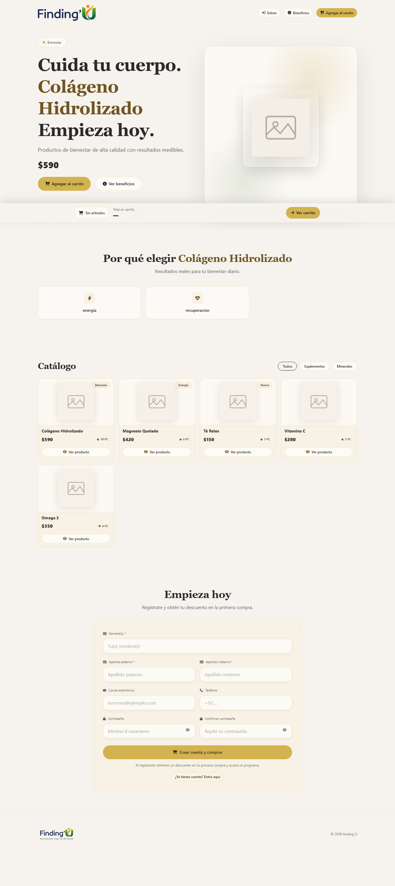

**Dashboard, desktop** (resumen `kpi-mini` arriba; badges Activa/Inactiva con mejor contraste):

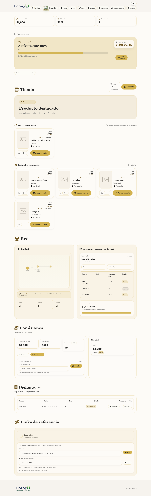

**Perfil, móvil** (toast reanclado arriba; CURP ya no queda tapada):

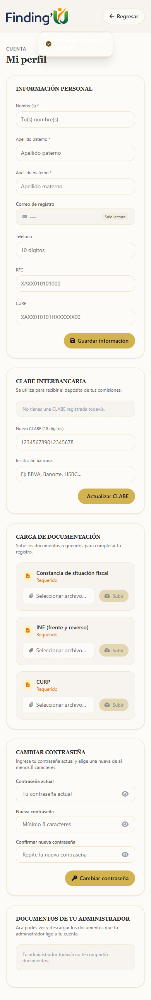

**Seguimiento de orden, desktop** ("Cancelar orden" con variante danger):

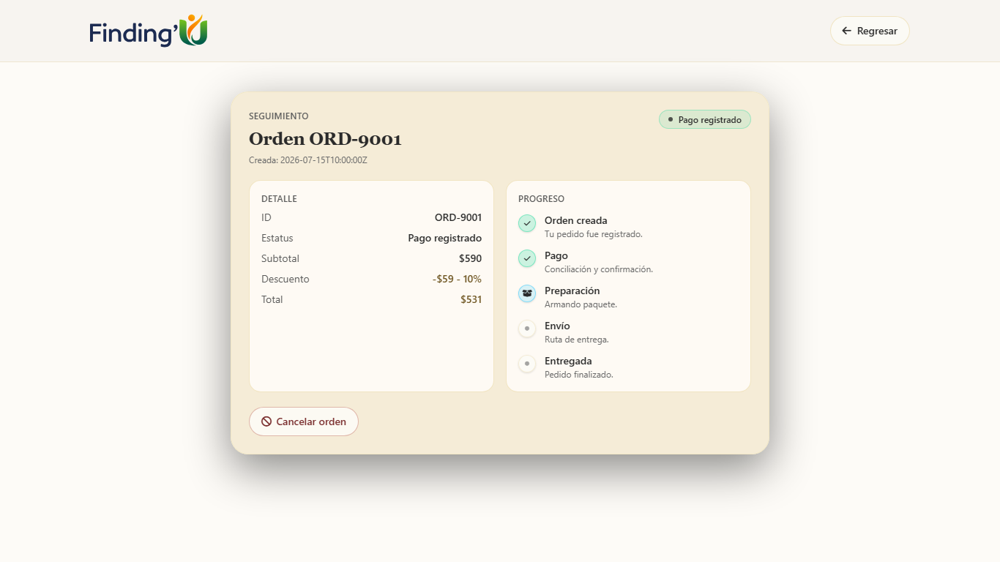

**Admin — Configuración, desktop** (índice de navegación por anclas):

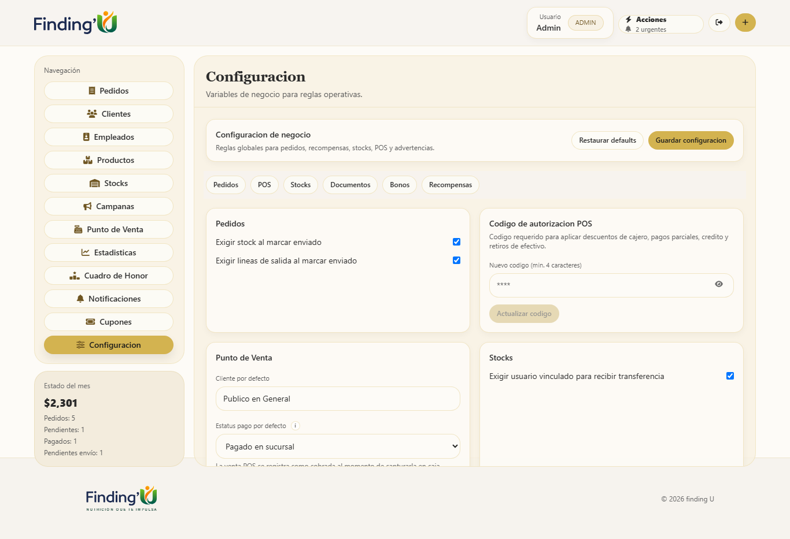

### Descartado (con motivo)

- **Admin Configuración como tabs reales (show/hide)**: la vista tiene ~450 líneas de formulario con más de una decena de sub-bloques y bindings `[ngModel]` interdependientes, dentro de un componente ya muy grande (`admin.component.ts`, ~6800 líneas). Restructurar a tabs con `*ngIf` por sección es un cambio de mayor superficie y riesgo de regresión que no se podía validar a fondo en este ciclo sin ampliar sustancialmente la matriz de pruebas manual. Se implementó en su lugar un índice de navegación por anclas (scroll suave) que resuelve el problema de fondo del hallazgo ("ubicar una regla específica obliga a scrollear a ciegas") con un cambio aditivo, no destructivo, y cero riesgo sobre los bindings existentes.
- **Resto de hallazgos Media/Baja del documento** (PLATINO con `ring` sin significado, indicador de fortaleza de contraseña, ilustración lateral en Login, jerarquía visual entre héroe/catálogo en Tienda, redundancia de badge/estatus en Order Status, contraste de filtros de categoría en Tienda, menú `⋮` para acciones de fila en Admin Productos, balance de columnas en Admin Catálogo, tabs de canal POS, KPI "Operador" fuera de la fila de cifras en POS, etc.): fuera de alcance de este ciclo (no son Alta ni top 10 ni quick win de accesibilidad); no se tocaron para mantener el diff enfocado y verificable.
